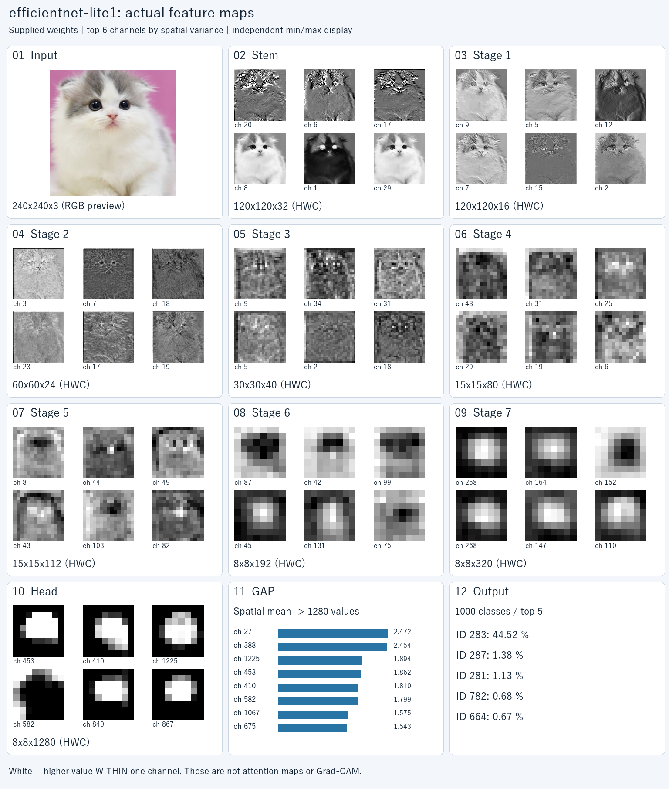

# EfficientNet-Lite 特徴マップ可視化

ローカルの `.pth` と画像を指定し、**実際の推論で得た特徴マップ**をPNGとオフラインHTMLで確認するPythonツールです。
EfficientNet-Lite0 / Lite1、任意のクラス数、ラベルファイル、モデル入力のRGB/BGR、出力先を選択できます。模式図の生成や代替の学習済み重みのダウンロードは行いません。

## 実測例

添付された猫画像と `efficientnet_lite1.pth` を使った結果です。入力画像は [examples/cat.png](examples/cat.png)。



- [Stemの全32チャネル](examples/lite1-rgb/stem_all_channels.png)
- [全層を選択して確認するHTML](examples/lite1-rgb/report.html) — リポジトリ取得後、ブラウザで開いてください。GitHubのファイル表示画面ではHTMLは実行されません。
- [実行条件・モデル/画像のSHA-256](examples/lite1-rgb/metadata.json)
- [分類出力](examples/lite1-rgb/predictions.json)

この例の重みは1000クラス出力です。学習履歴・クラス名・前処理設定は `.pth` に含まれていないため、fine-tuningの有無を断定せず、ラベル未指定の `class_ID` を表示しています。

## 対応モデルと制約

[RangiLyu/EfficientNet-Lite](https://github.com/RangiLyu/EfficientNet-Lite) の `stem.0.weight`、`blocks.0.0._depthwise_conv.weight`、`head.0.weight`、`fc.weight` 形式のstate_dictに対応しています。

- `efficientnet-lite0`：既定入力224×224、深さ係数1.0。
- `efficientnet-lite1`：既定入力240×240、深さ係数1.1。
- `fc.weight` からクラス数を取得します。凍結の有無にかかわらず、対応構造のfine-tuning済み重みを利用できます。
- 生のstate_dict、`state_dict` / `model_state_dict` に格納されたチェックポイント、全キーに `module.` が付いたDataParallel形式を読み込めます。
- `torch.load(..., weights_only=True)` と `load_state_dict(..., strict=True)` を使用。キーや形状が違う場合は停止します。モデルの自動置換・重みの部分読み込みはしません。
- timm / torchvisionのキー形式、TorchScript、ONNX、モデルオブジェクトをpickle保存したファイルは対象外です。構造コードを含まないstate_dictなので、演算方式が同じでも別キー形式なら変換が必要です。
- CPUで `eval()` と `inference_mode()` を使用。Dropoutは無効化し、BatchNormは保存済み統計量を使います。

## セットアップ

Python 3.10以上（この例はWindows / Python 3.12 / CPUで検証）。PyTorchのwheelが提供されているPythonバージョンを使用してください。

```powershell
python -m venv .venv
.\.venv\Scripts\python.exe -m pip install --upgrade pip
.\.venv\Scripts\python.exe -m pip install -r requirements.txt
```

CPU版PyTorchのみ必要な場合は、先に次を実行してからrequirementsをインストールできます。

```powershell
.\.venv\Scripts\python.exe -m pip install torch --index-url https://download.pytorch.org/whl/cpu
```

Linux/macOSでは以降の `.\.venv\Scripts\python.exe` を `.venv/bin/python` に置き換えてください。実行時のインターネット接続は不要です。

## 実行方法

### Lite1 / RGB / 全演算出力

リポジトリのルートで実行します。モデルは手元に配置してください。

```powershell
.\.venv\Scripts\python.exe feature_maps.py --weights "C:\Users\thatb\Downloads\efficientnet_lite1.pth" --image examples/cat.png --model efficientnet-lite1 --channel-order rgb --output runs/lite1-rgb --save-tensors
```

### Lite0 / BGR / ラベル指定

```powershell
.\.venv\Scripts\python.exe feature_maps.py --weights models/efficientnet_lite0.pth --image input.png --labels labels.txt --model efficientnet-lite0 --channel-order bgr --output runs/lite0-bgr
```

**RGB/BGRは、モデルへ渡すテンソルのチャネル順です。** PNG/JPEGはPillowでRGBにデコードし、`bgr` 指定時にB,G,Rの順に並べ替えます。OpenCVの配列を直接受け取るオプションではありません。RGBで学習したモデルには通常 `rgb` を指定します。保存される入力プレビューは見やすいRGB画像のままです。

### 学習時の前処理に合わせる

```powershell
.\.venv\Scripts\python.exe feature_maps.py --weights model.pth --image input.jpg --model efficientnet-lite1 --output runs/custom --size 240 --resize-mode stretch --mean 0.485 0.456 0.406 --std 0.229 0.224 0.225 --channels 12 --top-k 10
```

上の平均・標準偏差は設定方法の例です。自分の学習時の値を指定してください。

## オプション

| 引数 | 内容 | 既定値 |
|---|---|---|
| `--weights` | `.pth` のパス | 必須 |
| `--image` | 入力画像のパス | 必須 |
| `--labels` | TXTまたはJSONのクラス名 | 未指定なら `class_ID` |
| `--model` | `efficientnet-lite0` / `efficientnet-lite1` | `efficientnet-lite1` |
| `--channel-order` | モデルに渡す `rgb` / `bgr`（大文字も可） | `rgb` |
| `--output` | 新規または空の出力ディレクトリ | 必須 |
| `--size` | 入力の高さ・幅 | Lite0=224、Lite1=240 |
| `--resize-mode` | `eval`=短辺size+32へリサイズ後、中央sizeを切り出す / `stretch`=画像全体をsize×sizeへ変形 | `eval` |
| `--mean` | 0〜1変換後に引く3チャネルの平均 | `0.498 0.498 0.498` |
| `--std` | 平均を引いた後に割る3チャネルの標準偏差 | `0.502 0.502 0.502` |
| `--channels` | 各層の画像に表示するチャネル数 | 8 |
| `--top-k` | レポートに出す分類上位数 | 5 |
| `--scope` | `all`=内部Conv・BN・MBConv出力も保存 / `stages`=Stem・Stage1〜7・Head | `all` |
| `--save-tensors` | 表示対象以外も含め、全抽出テンソルをNPZへ保存 | 無効 |
| `--font` | PNGに使うTTF/TTCファイル | OSのフォントを自動選択 |
| `--threads` | PyTorch CPUスレッド数 | 4 |

`--mean` / `--std` は**指定したチャネル順**で入力します。BGRでチャネルごとに異なる値を使う場合はB,G,R順に指定してください。

既定の前処理は、対応する[公開実装の評価コード](https://github.com/RangiLyu/EfficientNet-Lite/blob/main/train.py)に合わせています。画像のEXIF回転を適用し、RGBへ変換、BICUBIC補間、中央切り出し、0〜1変換、`(x-mean)/std` の順に処理します。元の学習条件は重みだけから特定できないため、必要に応じて変更してください。

出力フォルダが空でない場合はエラーにします。再実行時は別の出力先を指定してください。

## ラベル形式

**行番号 / 配列インデックス / JSONキーは0始まりで、学習時のクラス順に一致させてください。** クラス数とエントリ数が違う場合は停止します。ラベルは入力の正解ではなく、モデルの出力IDに対応する名前です。

TXT（UTF-8、1行1クラス）：

```text
cat
dog
other
```

JSON配列：

```json
["cat", "dog", "other"]
```

JSONオブジェクト：

```json
{"0": "cat", "1": "dog", "2": "other"}
```

`labels.example.txt` は形式説明用の3クラスです。1000クラスモデルの例には使えません。Imagenetなどのクラス名は推測して自動付与しません。

## 出力と図の読み方

```text
output/
  report.html                   # ネット不要。全層の選択表示、分類結果
  overview.png                  # 入力 → Stem → Stage1〜7 → Head → GAP → 出力
  stem_all_channels.png         # Stemの全32チャネル
  input_original.png            # EXIF回転適用後の入力画像
  input_preprocessed_rgb.png    # 切り出し/リサイズ後のRGBプレビュー
  feature_maps/layer_*.png      # 各層の出力画像
  metadata.json                 # 引数、環境、重み/画像/ラベルのSHA-256、層情報
  layer_shapes.csv              # 各層のCHWサイズ、最小値・最大値
  predictions.json              # 全クラスのID・ラベル・logit・softmax
  activations.npz               # --save-tensorsを指定した場合のみ
```

- 概要図は各層から空間分散の大きい6チャネルを表示します。層別画像は `--channels` 枚です。全チャネルの数値はNPZに保存できます。
- `H×W×C` は高さ×幅×チャネル数。CSVとNPZはPyTorch側の `C×H×W`、正規化済み入力のみ `1×C×H×W` です。
- Stemは `Conv → BN → ReLU6` 後。各Stageは最後のMBConvの残差加算後。Headも `Conv → BN → ReLU6` 後です。
- `stem.0` はStemの畳み込み直後、`stem.1` はBN直後。`blocks.1.0._depthwise_conv` はStage2・第1ブロックのDepthwise畳み込み直後です。内部名のStage/ブロック番号は0始まりです。
- `blocks.1.0` などはMBConv全体の出力です。共有ReLUモジュール単体の呼び出しは保存しません。GAPは空間構造がないため、数値と概要図の棒グラフで示します。
- 特徴マップごとに最小値=黒、最大値=白として表示します。定数マップは黒。拡大時は最近傍補間を使います。
- **異なるマップの白さは絶対強度として比較できません。** 元の値は各画像の下部、CSV、NPZに記録しています。
- 白い部分が「猫を見ている位置」とは限りません。この出力はGrad-CAMではありません。

数値の読み込み例：

```python
import numpy as np
with np.load("runs/lite1-rgb/activations.npz", allow_pickle=False) as data:
    stem = data["Stem"]                # (32, 120, 120)
    one_channel = stem[20]              # 表示変換前の実数値
    head = data["Head"]                # (1280, 8, 8)
    probabilities = data["probabilities"]
```

## 検証

```powershell
.\.venv\Scripts\python.exe -m unittest discover -s tests -v
```

テストではRGB/BGRと正規化、中央切り出し、TXT/JSONラベル、Lite0の保存・読み込み・推論、DataParallel形式、モデル種類の不一致、Conv出力を活性化で上書きしないことを確認します。Lite0のテスト重みは人工生成であり、分類品質を検証するものではありません。
同梱のLite1猫画像の例は指定された実際の重みから生成しています。モデル本体・巨大なNPZ・実行環境はリポジトリに含めず、`.gitignore` で除外しています。

## 参照

- モデル構造：[RangiLyu/EfficientNet-Lite / efficientnet_lite.py](https://github.com/RangiLyu/EfficientNet-Lite/blob/main/efficientnet_lite.py)
- 既定前処理：[同 train.py](https://github.com/RangiLyu/EfficientNet-Lite/blob/main/train.py)
- 元のLiteモデル：[tensorflow/tpu EfficientNet-Lite](https://github.com/tensorflow/tpu/tree/master/models/official/efficientnet/lite)

同梱の猫画像はこの会話でユーザーから提供されたサンプルで、元画像に含まれる表記を維持しています。画像・モデルの権利や配布条件を本ツール独自のライセンスで置き換えるものではありません。
